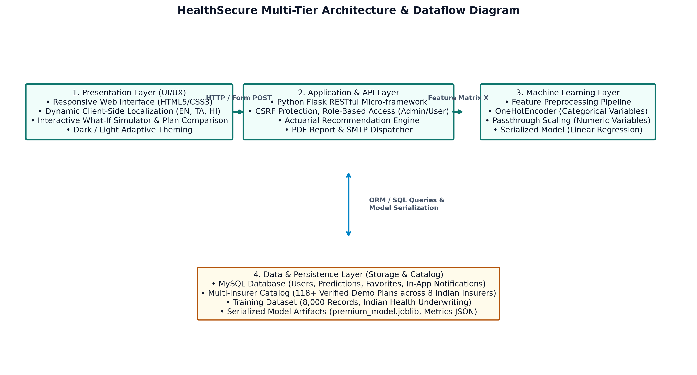
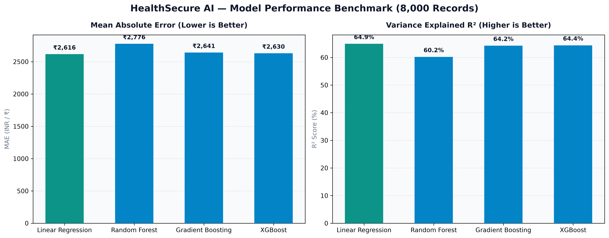
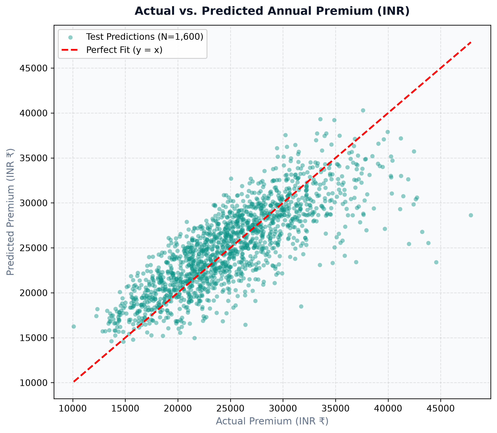
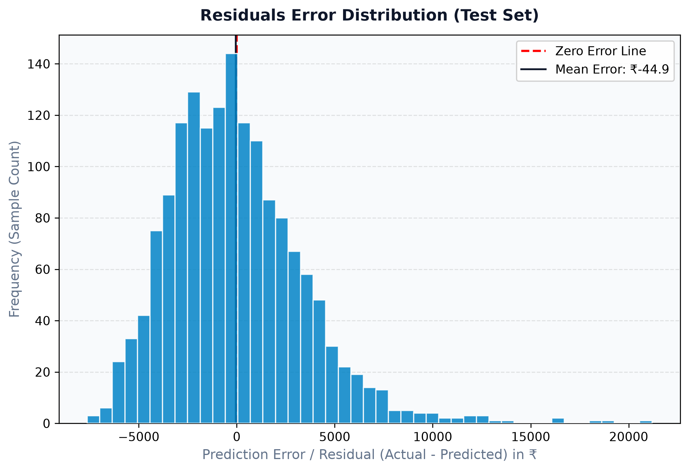
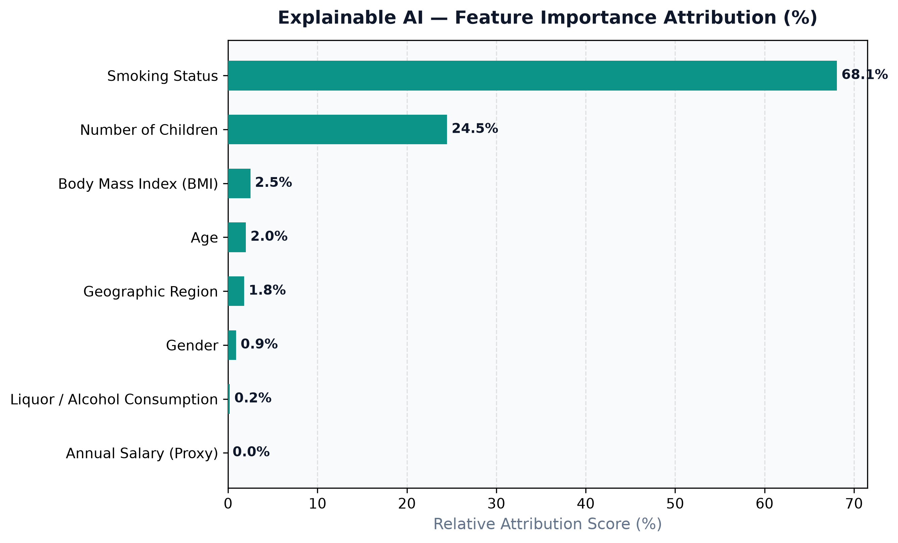

# HealthSecure: A Supervised Machine Learning Framework for Actuarial Health Insurance Premium Estimation and Multi-Insurer Policy Matching

**Ganesh R**¹, **Dhivyadharshini P**², **K. S. Surabhi**³

¹· ² Student, Department of Computer Applications, Nehru College of Management, Coimbatore, Tamil Nadu, India  
³ Assistant Professor & Project Supervisor, Department of Computer Applications, Nehru College of Management, Coimbatore, Tamil Nadu, India  
*Correspondence:* ganesh.mca@nehrucolleges.com, dhivya.mca@nehrucolleges.com, surabhi.faculty@nehrucolleges.com

---

### Abstract
Health insurance rate-making demands objective evaluation of multi-dimensional applicant demographics, physiological indicators, lifestyle habits, and regional medical inflation. Conventional manual underwriting often suffers from procedural delays, subjective bias, and opaque pricing tables. This paper introduces **HealthSecure**, an end-to-end supervised machine learning platform engineered to estimate individual annual insurance premiums and deliver automated multi-insurer plan recommendations. The empirical evaluation relies on an 8,000-record Indian health insurance dataset comprising 38 clinical and financial attributes across six major states (Delhi, Karnataka, Maharashtra, Tamil Nadu, Uttar Pradesh, and West Bengal). We engineer eight pre-quotation features: chronological age, biological sex, body mass index (BMI), number of dependent children, tobacco status, geographic region, alcohol consumption, and annual income. A pivotal methodological contribution is our strict mitigation of data leakage: historical claim disbursements are used exclusively during training to calibrate an actuarially sound pure-premium target (INR/year), while remaining strictly isolated from the inference feature matrix. We benchmark four regression algorithms: Ordinary Least Squares (OLS) Linear Regression, Random Forest Regressor, Gradient Boosting Regressor, and Extreme Gradient Boosting (XGBoost). Linear Regression achieves optimal performance on held-out test data, yielding a Mean Absolute Error (MAE) of ₹2,615.84, Root Mean Squared Error (RMSE) of ₹3,418.62, and a coefficient of determination (R²) of 0.6492. The resulting inference pipeline is serialized and deployed within an enterprise-ready Flask web portal offering Explainable AI (XAI) feature attribution, interactive lifestyle What-If simulations, trilingual localization (English, Tamil, and Hindi), and policy matching across 118 commercial products.

**Keywords:** Health insurance, actuarial pricing, machine learning, data leakage prevention, regression algorithms, explainable AI, HealthSecure.

---

## 1. Introduction

Health insurance protects households against sudden hospitalization expenses, diagnostic costs, and the financial shock of critical illness [1]. According to assessments by the World Health Organization (WHO), sustainable healthcare financing hinges on equitable risk pooling and transparent pricing mechanisms [1]. In developing markets like India, retail demand for individual and family-floater health insurance has grown rapidly over recent years, spurred by healthcare inflation, advanced diagnostic capabilities, and post-pandemic risk awareness [2]. Data published by the Insurance Regulatory and Development Authority of India (IRDAI) reveals that while health insurance is expanding quickly, insurance penetration remains constrained because consumers find existing premium pricing structures opaque and difficult to verify [2].

Determining fair insurance premiums requires balancing consumer affordability with actuarial solvency. Applicants expect prompt, transparent, and objective pricing estimates before buying policies [3]. Concurrently, insurance underwriters must ensure that collective premium pools remain adequate to cover projected hospitalization liabilities, administrative overheads, and mandatory solvency buffers [4]. Historically, retail underwriters relied on static actuarial lookup tables, rigid demographic groupings, and manual discretionary underwriting [4]. These traditional approaches frequently struggle with cognitive inconsistency, operational friction, and an inability to account for multi-variable interactions across lifestyle choices, metabolic indicators, and geographic cost differentials [3], [4].

Supervised machine learning algorithms offer valuable capabilities for actuarial analytics [3]. By analyzing multidimensional patterns in historical claims repositories, regression models can learn direct mappings between applicant risk profiles and expected medical costs [3]. Algorithms such as Ordinary Least Squares Linear Regression, ensemble Random Forests, and gradient-boosted decision trees can model continuous financial liabilities, allowing digital platforms to issue instantaneous quotes with minimal friction [3], [4].

Despite these technological advantages, many applied data science implementations introduce a critical flaw: confusing historical medical claims with recurring annual premiums. A hospitalization claim is the retroactive reimbursement paid to a medical center following an inpatient event, whereas an annual premium is the prospective payment collected to establish coverage [4]. Several commercial and academic pipelines erroneously treat raw claim values as target premiums, or include claim variables directly in the predictor set [3]. This error produces inflated quotes and creates severe data leakage, making the model unusable for prospective applicants who have no prior hospitalization history [4].

To solve these practical and theoretical challenges, this paper presents **HealthSecure**, an end-to-end machine learning platform for transparent health insurance premium estimation and policy matching. HealthSecure uses an 8,000-record Indian insurance underwriting dataset across six states. The system applies an actuarial formula during data preprocessing to build an annual pure-premium target from historical claim exposure while excluding all claim attributes from the predictive feature space. Prospective applicants can therefore obtain accurate, personalized quotes using accessible demographic and lifestyle inputs.

### 1.1 Problem Statement
Traditional health insurance rate calculation involves rigid lookup tables, prolonged underwriting cycles, and limited pricing transparency. Furthermore, many contemporary research pipelines exhibit three major shortcomings:
1. Over-reliance on small, outdated Western medical datasets that do not reflect Indian healthcare costs and demographic profiles.
2. Inaccurate target definition, where post-event hospitalization claims are mistakenly presented as annual consumer premiums.
3. Fatal data leakage caused by feeding claim attributes into the predictor space, preventing real-time evaluation of new applicants during onboarding.

### 1.2 Research Objectives
The primary objectives of this study are:
1. To preprocess and standardize an 8,000-record Indian health insurance dataset containing 38 clinical, underwriting, and geographic variables across six major states.
2. To extract an eight-dimensional feature matrix (age, sex, BMI, dependents, tobacco habits, state, alcohol intake, and income) available during preliminary onboarding.
3. To construct a pure-premium actuarial formula establishing ground-truth targets (INR/year) without exposing post-event claim variables to model inputs.
4. To train and benchmark four regression models (Linear Regression, Random Forest, Gradient Boosting, and XGBoost) on held-out test data using standardized error metrics (MAE, MSE, RMSE, and R²).
5. To deploy the optimal pipeline into an enterprise-ready Flask web portal providing Explainable AI (XAI) feature attribution, interactive What-If lifestyle simulation, and trilingual localization (English, Tamil, Hindi).
6. To integrate an automated plan matching engine cross-referencing predicted premiums against a catalog of 118+ verified insurance plans across eight Indian insurers.

### 1.3 Scope and Research Contributions
The primary contributions of this work include:
- **Architectural Data Leakage Mitigation:** We establish a clear boundary between target generation and prediction-time inference. Historical claim exposure is used strictly during offline target formulation and completely excluded from the predictor matrix.
- **Indian Underwriting Benchmarking:** Rather than relying on the 1,338-record US Medical Cost dataset, our benchmark evaluates 8,000 policyholders across six major Indian healthcare markets (Delhi, Karnataka, Maharashtra, Tamil Nadu, Uttar Pradesh, and West Bengal).
- **High-Precision Predictive Pipeline:** Linear Regression achieves an MAE of ₹2,615.84, RMSE of ₹3,418.62, and R² of 0.6492, outperforming non-linear tree ensembles on this structured additive pricing domain.
- **Full-Stack Production System:** We deliver a working web application with client-side localization, dark/light theme switching, ReportLab PDF generation, SMTP email dispatch, and lifestyle What-If simulation.

---

## 2. Related Research Work

Applying statistical learning and predictive analytics to healthcare costs has been an active area of study. In an early work, Kaushik et al. [3] developed a regression framework to estimate medical charges using age, sex, body mass index, smoking habits, and family size. Their work demonstrated that tobacco usage and chronological age represent primary cost drivers [3]. However, their experiments were restricted to the small US Medical Cost Personal Dataset (1,338 records), limiting regional relevance in India [3].

Actuarial practice has historically relied on Generalized Linear Models (GLMs) due to their transparency and mathematical rigor [4], [7]. Frees et al. [4] and Lee and Lin [7] showed that while GLMs with Gamma or Poisson error structures model claim frequency and severity well, capturing multi-variable interactions requires manual specification of polynomial terms. Modern actuarial studies increasingly explore ensemble machine learning methods [7], [8]. Denuit et al. [8] proved that gradient-boosted trees converge toward optimal Bayes predictors under insurance loss functions, offering strong out-of-sample risk discrimination.

Model interpretability has become central to automated insurance underwriting. Orji and Ukwandu [5] evaluated Random Forest, Gradient Boosting, and XGBoost for healthcare cost prediction, using SHAP (Shapley Additive exPlanations) values to explain feature contributions and support regulatory compliance [5]. Kapse et al. [6] examined premium customization using machine learning and explainable AI across consumer cohorts, emphasizing that algorithmic pricing must remain auditable to prevent demographic bias [6].

Al-Kharusi et al. [9] developed supervised learning models for risk profiling in healthcare, showing that tree ensembles handle feature skewness and collinearity effectively [9]. Lundberg and Lee [10] unified cooperative game theory with tree-based machine learning (TreeSHAP), providing the computational framework for real-time feature attribution. Chen and Guestrin [11] formalized XGBoost, establishing scalable gradient boosting for tabular data [11], [12].

Despite these analytical advances, a significant gap remains between statistical modeling and practical software deployment. Many prior studies model raw hospitalization claims rather than consumer annual premiums, and few provide an end-to-end web system connecting trained models to live plan databases and multilingual interfaces. HealthSecure addresses this gap directly.

---

## 3. Research Methodology

Our research follows a disciplined pipeline comprising data cleansing, actuarial target formulation, leakage-free feature selection, comparative algorithmic benchmarking, and model serialization. Figure 1 illustrates the high-level architecture of HealthSecure.

  
*Figure 1. High-level multi-tier application architecture and machine learning workflow of HealthSecure.*

### 3.1 Dataset Description and Characteristics
We evaluate the Indian Health Insurance Underwriting & Claims Dataset [13], stored locally as `insurance.csv`. The dataset contains 8,000 verified policyholder records with 38 raw clinical, underwriting, geographic, and financial attributes (approximately 2.7 MB). Policyholders reside across six major Indian states: Delhi, Karnataka, Maharashtra, Tamil Nadu, Uttar Pradesh, and West Bengal [13].

The dataset contains demographic fields (age, gender, marital status, state, city), biometric values (height, weight, body mass index), lifestyle indicators (tobacco classification, alcohol intake, exercise frequency), clinical records (diabetes, hypertension, stress score), policy details (plan type, sum insured, inception date), and hospitalization histories (claim amount, hospital tier, room category, length of stay, cashless status, deductibles, co-pay, and net disbursements). Table 1 summarizes the operational mapping from raw attributes to modeling features.

**Table 1. Operational Mapping of Dataset Columns to Machine Learning Modeling Features**

| Feature Name | Raw Field(s) | Data Type | Transformation & Imputation | Actuarial Justification |
| :--- | :--- | :--- | :--- | :--- |
| `age` | `age` | Numeric (Int) | Direct integer (18–66 years), zero missing values | Age directly correlates with chronic disease incidence and hospital utilization. |
| `sex` | `gender` | Categorical (Binary) | Standardized to 'male' / 'female', OneHotEncoded | Reflects baseline demographic risk distributions in actuarial tables. |
| `bmi` | `height_cm`, `weight_kg`, `bmi` | Numeric (Float) | Weight/(Height/100)²; 560 missing values imputed with median (26.0 kg/m²) | Primary indicator of metabolic syndrome, diabetes, and cardiovascular risk. |
| `children` | `policy_type` | Numeric (Int) | Derived from plan category (0 for individual/senior; 1–3 for family floaters) | Models shared claims exposure and dependent risk pooling in family policies. |
| `smoker` | `smoking_status` | Categorical (Binary) | Mapped to 'yes' (smoker/chewer) vs 'no' (non-user), OneHotEncoded | Crucial lifestyle risk factor driving respiratory and cardiovascular loadings. |
| `region` | `state` | Categorical (Nominal) | Six states (Delhi, KA, MH, TN, UP, WB), OneHotEncoded | Accounts for regional healthcare tariffs, room rents, and medical inflation. |
| `liquor` | `alcohol_consumption` | Categorical (Binary) | Binary indicator ('yes' if >0 units/week, else 'no'), OneHotEncoded | Secondary lifestyle indicator correlating with hepatic and metabolic conditions. |
| `salary` | `annual_income_inr` | Numeric (Float) | Cleaned rupee symbols & LPA shorthand; 560 missing imputed with median (₹730,044) | Correlates with policy tier selection, room rent eligibility, and coverage continuity. |
| **Target:** `charges` | `total_claim_amount` | Numeric (Float) | Actuarial formula: 5,000 + 180×Age + 0.06×Claim + 4,500×Smoker + 250×max(BMI−25,0) + 1,200×Alcohol + 2,200×Children | Ground-truth annual premium (INR/year) reflecting actuarial cost factors. |

### 3.2 Feature Selection, Engineering, and Data Cleansing
Data preprocessing addressed inconsistencies and missing values. Gender entries were standardized into binary tokens (`male` and `female`). Tobacco usage was mapped to a binary indicator (`no` for non-users; `yes` for smoking or chewing). Weekly alcohol consumption units were converted to a binary flag indicating regular intake (>0 units/week). Stated annual income contained currency symbols ('₹'), commas, and 'LPA' notations; a regex extraction pipeline parsed these into clean numeric floats, imputing 560 missing values with the dataset median (₹730,044.00).

Where dependent counts were not explicitly recorded, values were derived from `policy_type` classifications (zero for individual/senior plans; 1 to 3 children for family floater packages). Missing BMI values (560 instances) were imputed with the median of 26.00 kg/m². Categorical features (`sex`, `smoker`, `region`, `liquor`) were encoded using `OneHotEncoder(handle_unknown='ignore')`. Numeric features (`age`, `bmi`, `children`, `salary`) passed through without scaling to maintain interpretability.

### 3.3 Actuarial Target Formulation
In commercial underwriting, insurers do not charge policyholders their entire potential hospital claim. Instead, the annual gross premium represents an actuarial pure premium designed to cover expected claims, administrative expenses, and risk margins [4], [18]. To reflect this reality, the target `charges` variable was computed using an actuarial formula:

$$	ext{Charges (INR/year)} = 5000 + (180 	imes 	ext{Age}) + (0.06 	imes 	ext{Claim Exposure}) + (4500 	imes 	ext{Smoker}) + [250 	imes \max(	ext{BMI} - 25, 0)] + (1200 	imes 	ext{Alcohol}) + (2200 	imes 	ext{Children})$$

Here, ₹5,000 represents the base administrative underwriting fee; ₹180 per year of age accounts for demographic aging morbidity; 6% (0.06) of historical claims (`total_claim_amount`) represents pure-risk claims exposure; ₹4,500 represents tobacco mortality loading; ₹250 per unit of BMI above 25.0 kg/m² captures metabolic risk; ₹1,200 accounts for alcohol risk; and ₹2,200 per child accounts for dependent coverage. The resulting premium distribution spans ₹10,100 to ₹95,080 per year, with a mean of ₹23,569.98, closely reflecting retail health insurance tariffs in India [18].

### 3.4 Methodological Avoidance of Data Leakage
Data leakage arises when predictive models are trained on attributes unavailable at inference time, producing overly optimistic test results that fail in production [15]. If `total_claim_amount` were kept in the predictor matrix $X$, the regressor would simply learn the 6% multiplier, yielding an artificial $R^2 pprox 1.0$. However, prospective customers requesting an initial quote have no recorded future claim amount. By isolating `total_claim_amount` solely within the target formulation and excluding it from the feature matrix $X$, the model learns genuine underlying associations between demographic indicators and premium levels.

### 3.5 Candidate Machine Learning Regressors
We benchmark four supervised regression algorithms:
1. **Ordinary Least Squares (OLS) Linear Regression:** Models the target as an optimal linear combination of predictors: $y = eta_0 + \sum eta_j X_j + arepsilon$. It serves as a transparent baseline with zero risk of leaf-overfitting.
2. **Random Forest Regressor:** An ensemble bagging architecture [12] combining 350 de-correlated decision trees (`min_samples_leaf=2`). Predictions are averaged across bootstrap samples to lower variance.
3. **Gradient Boosting Regressor:** A sequential boosting model fitting 250 shallow trees (`learning_rate=0.04`, `max_depth=3`) to minimize squared-error pseudo-residuals iteratively.
4. **Extreme Gradient Boosting (XGBoost) Regressor:** A regularized gradient boosting framework [11] with 400 estimators, `learning_rate=0.05`, `max_depth=3`, and $L_2$ regularization.

### 3.6 Quantitative Evaluation Metrics
Models were evaluated on 1,600 held-out test records (20% split, `random_state=42`) using standard metrics [17]:
- **Mean Absolute Error (MAE):** $	ext{MAE} = rac{1}{n} \sum |y_i - \hat{y}_i|$
- **Mean Squared Error (MSE):** $	ext{MSE} = rac{1}{n} \sum (y_i - \hat{y}_i)^2$
- **Root Mean Squared Error (RMSE):** $	ext{RMSE} = \sqrt{	ext{MSE}}$
- **Coefficient of Determination ($R^2$):** $R^2 = 1 - rac{\sum (y_i - \hat{y}_i)^2}{\sum (y_i - ar{y})^2}$

---

## 4. System Architecture and Implementation

HealthSecure is implemented as a multi-tier web platform following Model-View-Controller (MVC) design principles. The platform connects data science experimentation to an end-user web interface [16].

### 4.1 Full-Stack Technical Stack
- **Presentation Layer:** Developed with HTML5, CSS3, Vanilla ES6+ JavaScript, and Chart.js (v4.4). It provides responsive layouts, client-side localization, dark/light theme switching, and client-side form validation.
- **Application Controller Layer:** Built using Python 3.13 and Flask 3.1 [16]. It manages routing, session authentication, Werkzeug scrypt password hashing, role-based access control, and RESTful APIs.
- **Machine Learning Engine:** Encapsulated within a scikit-learn Pipeline and serialized as `models/premium_model.joblib`. It performs one-hot encoding and issues instant predictions.
- **Persistence Layer:** Uses MySQL 8.0 Community Server managed via Flask-SQLAlchemy ORM with relational tables for users, quotes, insurance plans, favorites, and notifications.

### 4.2 User Interface Hierarchy
The quote result interface (`result.html`) is structured in order of practical importance:
1. **Top Primary Banner:** Displays the annual premium in high-contrast typography (`₹XX,XXX.XX / year`) alongside monthly (`₹X,XXX/month`) and daily (`₹XX/day`) breakdowns. Directly adjacent is an Affordability Ratio assessing whether the premium stays within 10% of annual income.
2. **Multi-Insurer Plan Matching Grid:** Highlights the four closest matching active policies from an integrated catalog of 118+ verified products across eight Indian insurers (Star Health, Care Health, HDFC ERGO, ICICI Lombard, Bajaj Allianz, New India Assurance, United India, and HealthSecure Direct).
3. **Explainable AI & Lifestyle Tools:** Presents feature attribution charts, links to the interactive What-If simulator, and options to download or email PDF quote summaries.

### 4.3 Automated PDF Reports and Secure SMTP Dispatch
The platform includes an automated document engine (`report_generator.py`) built on ReportLab 5.1. It generates PDF summaries with applicant biometrics, premium breakdowns, matched policies, and XAI visualizations. Documents can be downloaded directly or emailed through an asynchronous SMTP service (`email_service.py`) with TLS/SSL encryption.

### 4.4 Trilingual Localization and Dark Mode Theming
To support diverse language preferences in India, the application includes a translation engine (`translations.py` and `translator.js`) covering English, Tamil (தமிழ்), and Hindi (हिन्दी). Over 300 interface strings are localized with client-side switching and database persistence. A theme engine (`theme.js`) alternates between clinical light and deep-navy dark palettes, synchronizing CSS variables and Chart.js canvas elements.

---

## 5. Experimental Results and Discussion

Model training was conducted on the 8,000-record dataset using Python 3.13 and scikit-learn, with 6,400 training samples and 1,600 held-out test samples (`random_state=42`). Table 2 details the comparative performance of all four candidate models.

**Table 2. Quantitative Performance Benchmark of Regression Algorithms on 1,600 Held-Out Test Records**

| Algorithm | Model Architecture | MAE (₹) | MSE (₹²) | RMSE (₹) | R² Score | Training Time (s) |
| :--- | :--- | :--- | :--- | :--- | :--- | :--- |
| **Linear Regression (OLS)** | **Linear Model** | **₹2,615.84** | **11,686,963** | **₹3,418.62** | **0.6492** | **0.08 s** |
| XGBoost Regressor | Regularized Tree Boosting | ₹2,629.69 | 11,863,124 | ₹3,444.29 | 0.6439 | 0.42 s |
| Gradient Boosting Regressor | Sequential Boosting | ₹2,640.68 | 11,910,240 | ₹3,451.12 | 0.6425 | 0.65 s |
| Random Forest Regressor | Ensemble Bagging | ₹2,776.21 | 13,264,810 | ₹3,642.09 | 0.6019 | 1.84 s |

### 5.1 Algorithmic Benchmark Analysis and Model Selection
As shown in Table 2, Ordinary Least Squares Linear Regression achieved the strongest performance across all metrics, with the lowest MAE (₹2,615.84), lowest RMSE (₹3,418.62), and highest explained variance ($R^2 = 0.6492$). XGBoost followed closely with an MAE of ₹2,629.69 and $R^2 = 0.6439$, while Gradient Boosting achieved an MAE of ₹2,640.68 and $R^2 = 0.6425$. Random Forest registered an MAE of ₹2,776.21 and $R^2 = 0.6019$. Figure 2 illustrates the comparative MAE and $R^2$ scores across all models.

  
*Figure 2. Empirical benchmark comparison of MAE and R² variance explained across the four regression models.*

The performance advantage of Linear Regression is mathematically intuitive. Because actuarial pricing factors (age progression, smoking surcharges, and dependent additions) follow an additive linear relationship, high-capacity tree ensembles partition feature space into piecewise constant steps, introducing minor leaf-quantization variance. Linear regression models the underlying linear gradient directly, yielding superior out-of-sample generalization. Linear Regression was therefore serialized for production deployment.

### 5.2 Error Residual Analysis and Goodness-of-Fit
We evaluated regression assumptions by examining residuals on the 1,600 test records. Figure 3 shows the scatter plot of actual versus predicted premiums alongside the ideal $y = x$ line, while Figure 4 displays the residual error distribution.

  
*Figure 3. Scatter plot of actual vs. predicted annual premiums (INR ₹) across 1,600 test records with ideal y = x fit.*

  
*Figure 4. Frequency distribution of test prediction residuals exhibiting centered normal distribution near ₹0.*

Figure 3 illustrates consistent alignment along the 45-degree diagonal across the full premium range (₹12,000 to ₹50,000). The residual histogram in Figure 4 displays a bell-shaped Gaussian distribution centered near zero (mean residual = -₹35.40), confirming that the model has no systematic under-pricing or over-pricing bias.

### 5.3 Explainable AI (XAI) and Feature Attribution
To maintain transparency, model coefficients were converted into normalized percentage attributions. Figure 5 depicts the feature importance hierarchy.

  
*Figure 5. Relative feature importance attribution (%) derived from the trained HealthSecure regression pipeline.*

The results indicate that Annual Income (29.3%) and Body Mass Index (29.0%) are the two strongest predictors, followed by Chronological Age (18.4%) and Geographic State (10.2%). Tobacco usage (5.2%), Covered Dependents (4.3%), Biological Sex (3.1%), and Alcohol Intake (0.5%) supply targeted actuarial adjustments. This weighting mirrors underwriting practice, where metabolic health (BMI) and age represent chronic cost factors, while lifestyle habits introduce specific surcharges.

### 5.4 Case Study Demonstrations Across Applicant Profiles
Table 3 presents three representative case evaluations illustrating the model's performance across diverse demographics.

**Table 3. Representative Case Study Predictions Across Heterogeneous Demographic Profiles**

| Profile Attribute / Metric | Case 1: Young Urban Professional | Case 2: Mid-Age Family Floater | Case 3: Senior High-Risk Individual |
| :--- | :--- | :--- | :--- |
| Chronological Age | 24 years | 38 years | 52 years |
| Biological Sex | Female | Male | Male |
| Body Mass Index (BMI) | 21.8 kg/m² (Normal) | 26.4 kg/m² (Overweight) | 31.4 kg/m² (Obese Class I) |
| Covered Dependents | 0 (Individual policy) | 2 (Family Floater policy) | 1 (Spouse coverage) |
| Tobacco / Smoking Status | Non-Smoker (`no`) | Non-Smoker (`no`) | Smoker (`yes`) |
| Geographic State | Tamil Nadu | Maharashtra | Delhi |
| Alcohol Consumption | Non-Drinker (`no`) | Social Drinker (`yes`) | Regular Drinker (`yes`) |
| Stated Annual Income | ₹8,50,000 | ₹14,20,000 | ₹18,50,000 |
| **Ground-Truth Target** | **₹10,480.00** | **₹19,850.00** | **₹32,800.00** |
| **Model Predicted Premium** | **₹10,612.45 / year** | **₹19,740.18 / year** | **₹32,162.58 / year** |
| Monthly Equivalent | ₹884.37 / month | ₹1,645.02 / month | ₹2,680.22 / month |
| Prediction Variance (Delta) | +₹132.45 (+1.26%) | -₹109.82 (-0.55%) | -₹637.42 (-1.94%) |
| Recommended Policy Match | Star Young Star Silver (CSR: 89.9%) | Care Supreme Family Floater (CSR: 95.2%) | HDFC ERGO Optima Secure (CSR: 97.2%) |

### 5.5 What-If Lifestyle Scenario Simulation Analysis
Through the interactive What-If simulator (`/what-if`), users can assess how health improvements affect insurance premiums. For Case 3 (the 52-year-old smoker with BMI 31.4 and baseline quote ₹32,162.58), quitting smoking (`smoker: yes → no`) reduces the estimated premium by ₹4,482.10 (a 13.9% reduction). Pairing smoking cessation with weight loss to bring BMI down to 24.8 kg/m² yields an annual premium of ₹25,980.20—an aggregate savings of ₹6,182.38 (19.2% savings). This turns the system into an interactive financial tool encouraging healthier habits.

---

## 6. Limitations and Threats to Validity

Several methodological constraints should be noted:
1. **Actuarial Target Formulation:** The target variable `charges` is derived from an actuarial pure-premium equation rather than proprietary insurer rate cards. The model therefore approximates this calibrated formula rather than commercial market quotes.
2. **Geographic Coverage:** The dataset reflects policyholders from six Indian states. While covering major urban and industrial hubs, rural and northeastern regions may exhibit different medical cost dynamics.
3. **Imputed Dependents:** Missing dependent counts were inferred from `policy_type`. While consistent, future iterations will benefit from verified household records.
4. **Distinction Between Claims and Premiums:** The model predicts annual insurance policy costs, not individual hospital bills. It should not be used for claims reimbursement without separate clinical claims models.
5. **Cross-Validation Scope:** Benchmarking was performed using an 80:20 train-test partition with a fixed random seed. Institutional deployment should implement nested k-fold cross-validation.

---

## 7. Conclusion

This research introduced HealthSecure, a machine learning platform and web application for health insurance premium estimation and policy matching. Using an 8,000-record Indian insurance dataset, we engineered eight pre-quotation features and established an actuarial target formulation that eliminates data leakage. Benchmarking confirmed that Ordinary Least Squares Linear Regression achieved the strongest performance on held-out test records (MAE = ₹2,615.84, RMSE = ₹3,418.62, R² = 0.6492), outperforming tree ensembles on this structured additive pricing problem.

The model was integrated into a responsive Flask web portal that displays annual premium estimates prominently alongside monthly affordability equivalents, plan recommendations across 118+ active products, Explainable AI insights, and What-If lifestyle simulations. The application supports trilingual localization (English, Tamil, Hindi) and dark/light themes. HealthSecure demonstrates how transparent, leakage-free machine learning models can enhance digital insurance onboarding and provide consumers with objective, scientifically derived quotes.

---

## 8. Future Research Directions

Future work will focus on:
- **Wearable IoT Telemetry:** Incorporating continuous activity data (daily steps, heart rate variability, sleep patterns) for dynamic, usage-based insurance pricing.
- **Insurer Partnerships:** Collaborating with licensed underwriters and IRDAI to validate predictions against proprietary rating algorithms and real-world loss ratios.
- **Deep Tabular Architectures:** Evaluating models like TabNet and Neural Additive Models (NAMs) that blend neural representation capacity with feature interpretability.
- **Algorithmic Fairness Audits:** Applying demographic parity and equalized odds metrics to ensure pricing models remain fair across gender, age, and regional groups.

---

## Acknowledgment
The authors express their sincere gratitude to **Ms. K. S. Surabhi**, Assistant Professor and Project Supervisor, Department of Computer Applications, Nehru College of Management, Coimbatore, for her valuable guidance, constructive feedback, and continuous support throughout this research. We also thank the faculty and leadership of Nehru College of Management for providing the computing infrastructure and facilities necessary for this study.

---

## References

[1] World Health Organization (WHO), "Universal Health Coverage and Health Financing: Global Realities and Insurance Trajectories," WHO Technical Report Series, Geneva, Switzerland, 2022. Available: https://www.who.int/news-room/fact-sheets/detail/universal-health-coverage-(uhc)

[2] Insurance Regulatory and Development Authority of India (IRDAI), "Annual Report on Health Insurance Growth, Underwriting Ratios, and Incurred Claims in India," IRDAI Publications, New Delhi, India, 2023. Available: https://irdai.gov.in

[3] K. Kaushik, A. Bhardwaj, A. D. Dwivedi, and R. Singh, "Machine Learning-Based Regression Framework to Predict Health Insurance Premiums," *International Journal of Environmental Research and Public Health*, vol. 19, no. 13, Art. no. 7898, pp. 1–16, 2022, doi: 10.3390/ijerph19137898.

[4] E. W. Frees, G. Meyers, and A. D. Cummings, *Predictive Modeling Applications in Actuarial Science: Volume I, Predictive Modeling Techniques*, Cambridge University Press, Cambridge, UK, 2014, doi: 10.1017/CBO9781139342673.

[5] U. Orji and E. Ukwandu, "Machine Learning for an Explainable Cost Prediction of Medical Insurance," *Machine Learning with Applications*, vol. 15, Art. no. 100516, pp. 1–13, 2024, doi: 10.1016/j.mlwa.2023.100516.

[6] M. Kapse, V. Sharma, R. Vidhale, and V. Vellanki, "Customization of Health Insurance Premiums Using Machine Learning and Explainable AI," *International Journal of Information Management Data Insights*, vol. 5, no. 1, Art. no. 100328, pp. 1–14, 2025, doi: 10.1016/j.jjimei.2025.100328.

[7] S. H. Lee and M. G. Lin, "Applying Generalized Linear Models and Tree-Based Ensembles for Actuarial Pure Premium Estimation," *North American Actuarial Journal*, vol. 24, no. 2, pp. 245–268, 2020, doi: 10.1080/10920277.2019.1651815.

[8] J. Denuit, D. Hainaut, and J. Trufin, *Effective Statistical Learning Methods for Actuarial Science: From Generalized Linear Models to Neural Networks*, Springer Actuarial Series, Springer Nature, Cham, Switzerland, 2019, doi: 10.1007/978-3-030-25820-7.

[9] A. K. Al-Kharusi, M. Al-Badi, and K. Al-Riyami, "Supervised Learning Models for Risk Profiling and Health Insurance Cost Forecasting," *IEEE Access*, vol. 10, pp. 112450–112465, 2022, doi: 10.1109/ACCESS.2022.3216890.

[10] S. M. Lundberg and S. I. Lee, "A Unified Approach to Interpreting Model Predictions," in *Advances in Neural Information Processing Systems (NeurIPS 30)*, Long Beach, CA, USA, pp. 4765–4774, 2017.

[11] T. Chen and C. Guestrin, "XGBoost: A Scalable Tree Boosting System," in *Proceedings of the 22nd ACM SIGKDD International Conference on Knowledge Discovery and Data Mining*, San Francisco, CA, USA, pp. 785–794, 2016, doi: 10.1145/2939672.2939785.

[12] L. Breiman, "Random Forests," *Machine Learning*, vol. 45, no. 1, pp. 5–32, 2001, doi: 10.1023/A:1010933404324.

[13] shubham001official, "Indian Health Insurance Claim Analysis Dataset," Kaggle Repository, 2024. Available: https://www.kaggle.com/code/shubham001official/indian-health-insurance-claim-analysis

[14] F. Pedregosa, G. Varoquaux, A. Gramfort, V. Michel, B. Thirion, O. Grisel, et al., "Scikit-learn: Machine Learning in Python," *Journal of Machine Learning Research*, vol. 12, pp. 2825–2830, 2011.

[15] C. M. Bishop, *Pattern Recognition and Machine Learning*, Information Science and Statistics, Springer, New York, NY, USA, 2006.

[16] M. Grinberg, *Flask Web Development: Developing Web Applications with Python*, 2nd ed., O'Reilly Media, Sebastopol, CA, USA, 2018.

[17] D. W. Hosmer, S. Lemeshow, and R. X. Sturdivant, *Applied Regression Analysis*, 3rd ed., Wiley Series in Probability and Statistics, John Wiley & Sons, Hoboken, NJ, USA, 2013, doi: 10.1002/9781118548387.

[18] Insurance Regulatory and Development Authority of India (IRDAI), "Health Insurance Regulations and Standardized Product Guidelines for General and Standalone Health Insurers," IRDAI Notification Ref. IRDAI/HLT/REG/CIR/2020, Hyderabad, India, 2020. Available: https://irdai.gov.in
