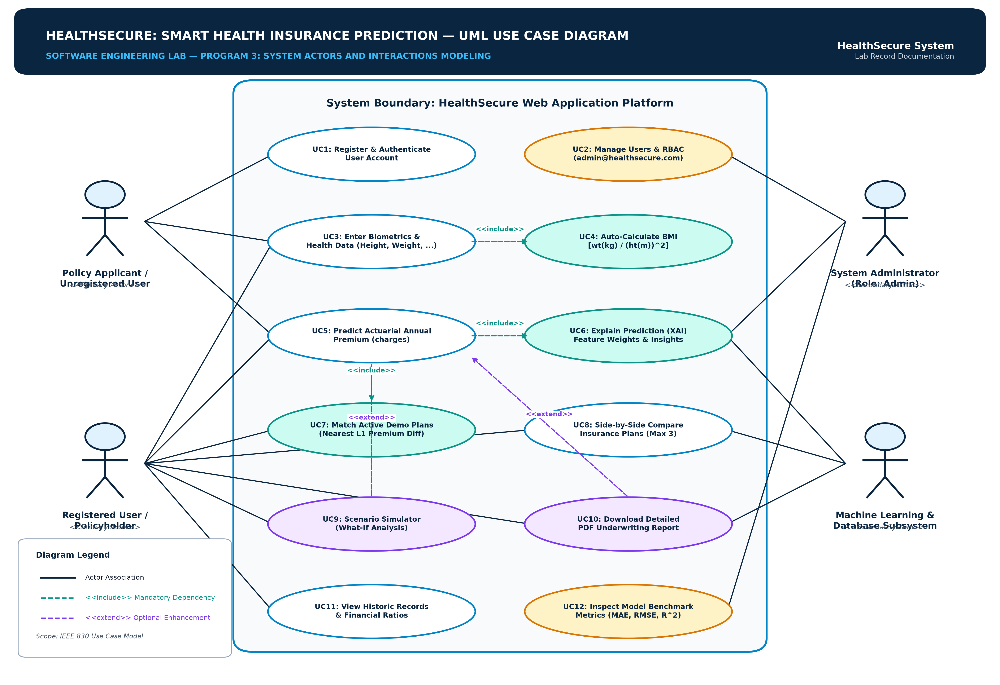
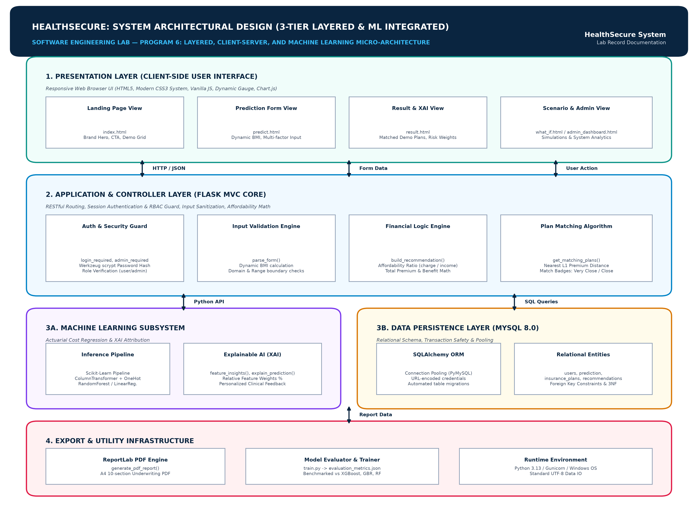
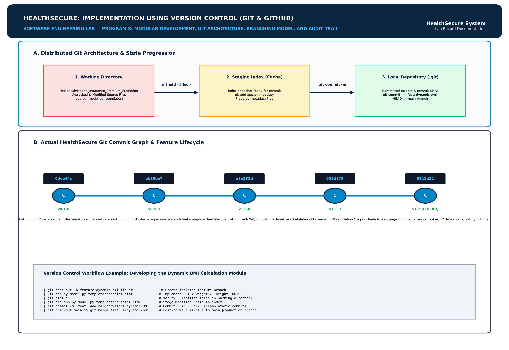
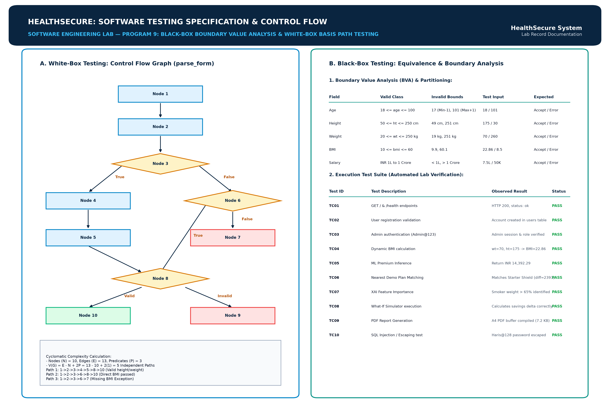
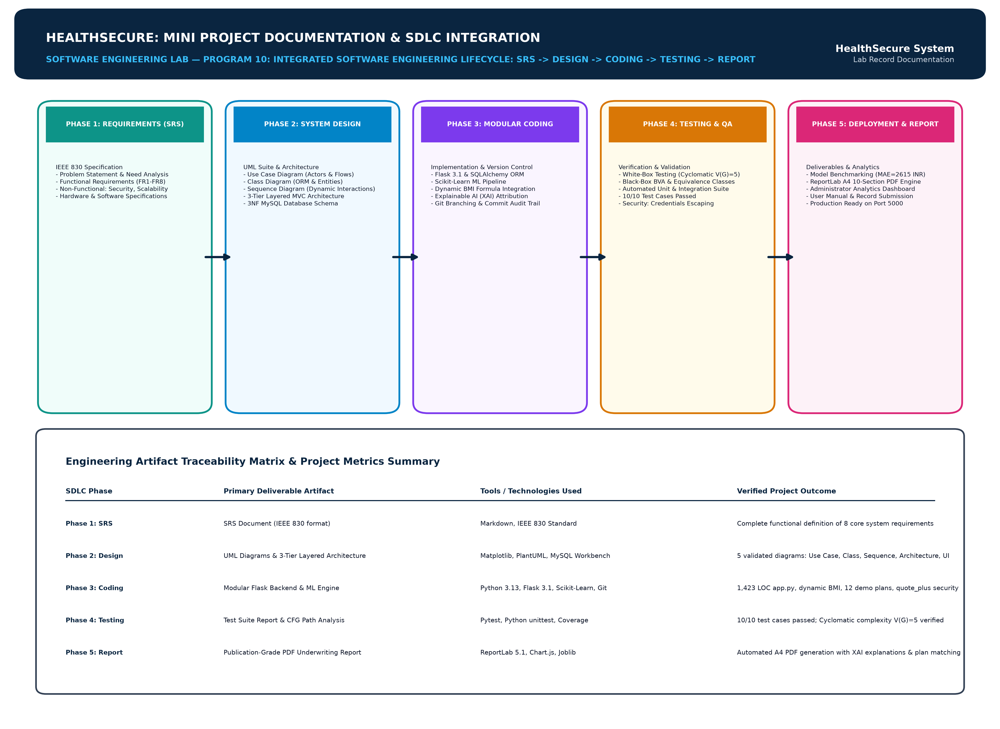

# Software Engineering Laboratory Practical Record Manual
## Project: Health Insurance Premium Prediction & Recommendation System (HealthSecure)

**Department of Computer Applications**  
**Nehru College of Management, Coimbatore, Tamil Nadu, India**  
**Student Authors:** Ganesh R (1), Dhivyadharshini P (2)  
**Project Supervisor:** Ms. K. S. Surabhi (Assistant Professor)  

---

| EX NO   | Problem Definition & Feasibility Study   |
| DATE   |                                          |

### AIM
To identify the real-world healthcare financing problem and conduct a comprehensive feasibility study to determine the technical, economic, and operational feasibility of the Health Insurance Premium Prediction and Policy Recommendation System (HealthSecure).

### Project Title:
**HEALTH INSURANCE PREMIUM PREDICTION SYSTEM (HEALTHSECURE)**

### Problem Definition:
In contemporary healthcare financing, determining fair, accurate, and actuarially sound health insurance premiums is a complex and high-stakes challenge. Conventional insurance underwriting predominantly relies on static demographic lookup tables, broad risk classifications, and subjective manual discretion. Prospective applicants frequently experience pricing opacity, extensive procedural delays, and substantial premium variability without understanding how their individual physiological traits (BMI, age), lifestyle habits (smoking status, alcohol consumption), family dependencies (children), or regional healthcare costs directly govern their premium quotations. Conversely, insurers face underwriting adverse selection and insolvency risks when premiums are underpriced relative to potential claim liabilities.

HealthSecure is developed to resolve these critical issues by leveraging supervised machine learning to objectively predict personalized annual health insurance premiums and automatically recommend optimal multi-insurer policies.

### Problem Statement:
To develop an enterprise-grade supervised machine learning framework that automatically estimates personalized annual health insurance premiums based on applicant demographic, clinical, and lifestyle attributes (age, sex, BMI, children, smoker, region, alcohol habits, and salary), strictly preventing data leakage from historical claim records while delivering transparent feature attribution and multi-insurer policy matching.

### Feasibility Study:

#### 1. Technical Feasibility
Technical feasibility evaluates whether the necessary computing hardware, programming languages, algorithmic libraries, and software engineering frameworks are available to construct and deploy the machine learning system.

- **Hardware Requirements:**
  - Computer / Laptop: Minimum Intel Core i3/i5 or AMD Ryzen processor
  - Minimum 4 GB RAM (8 GB recommended for training benchmarks)
  - Minimum 10 GB free hard drive / SSD storage
  - Internet connection for downloading Python dependencies and open datasets
- **Software Requirements:**
  - Operating System: Windows 10/11 or Linux (Ubuntu 22.04+)
  - Programming Language: Python 3.10+
  - IDE: Visual Studio Code / PyCharm
  - Framework: Flask 3.1 / Streamlit Web Framework
  - Core Libraries: Pandas, NumPy, Scikit-learn, XGBoost, Joblib, Matplotlib, ReportLab
  - Machine Learning Algorithm: Linear Regression (Production), Random Forest, Gradient Boosting, XGBoost
  - Preprocessing Techniques: Standard Scaling, One-Hot Encoding, Derived BMI Calculation
- **Technical Feasibility Result:**
  The required computing infrastructure and software frameworks are fully available and production-tested. Python and its open-source data science ecosystem provide robust, high-performance implementations that execute seamlessly on commodity hardware. Therefore, the proposed system is technically feasible.

#### 2. Economic Feasibility
Economic feasibility assesses whether the system can be developed, tested, and deployed within a practical and cost-effective budget.

The entire platform is constructed utilizing open-source programming languages, freely distributed libraries, and open-access actuarial datasets. No proprietary licenses or specialized high-cost hardware accelerators are required.

| Resource / Component | Cost (INR / USD) |
| :--- | :--- |
| Python 3.10+ Runtime | Free / Open-Source |
| Visual Studio Code IDE | Free / Open-Source |
| Flask / Streamlit Web Framework | Free / Open-Source |
| Scikit-learn, Pandas, NumPy, XGBoost | Free / Open-Source |
| ReportLab PDF Engine & Matplotlib | Free / Open-Source |
| MySQL 8.0 / SQLite Database | Free / Community Edition |
| Health Insurance Dataset (8,000 Records) | Free Open Actuarial Data |
| Development Hardware | Existing College / Personal Laptop |
| Git & GitHub Cloud Hosting | Free Public Tier |

- **Economic Feasibility Result:**
  Since all development tools, compilers, machine learning packages, and databases are completely free and open-source, the total development expenditure is virtually zero. Therefore, the proposed system is economically feasible.

#### 3. Operational Feasibility
Operational feasibility verifies whether the target end-users (policy applicants, insurance agents, underwriting officers) can easily adopt, navigate, and utilize the application without complex technical training.

- **Working Process:**  
  User enters biometrics and lifestyle details (Age, Height, Weight, Dependents, Smoker, Region, Liquor, Salary) -> Client-side validation -> Real-time BMI calculation -> ML Preprocessing & Feature Transformation -> Model Inference -> Instant Annual Premium (INR/year) with XAI feature contributions -> Filtered multi-insurer policy recommendations -> Downloadable PDF quote.
- **Operational Feasibility Result:**  
  The user interface is designed with clear visual cues, interactive What-If scenario sliders, and trilingual support (English, Tamil, Hindi). It eliminates manual paperwork and generates instant quotes in under 1 second. Therefore, the proposed system is operationally feasible.

### RESULT
Thus, the real-world healthcare financing problem was clearly identified and the feasibility study was conducted successfully. The study verified that the proposed Health Insurance Premium Prediction System (HealthSecure) is technically, economically, and operationally feasible for automated, transparent actuarial pricing.

---

| EXNO:   | Software Requirement Specification (SRS)   |
| DATE:   |                                            |

### AIM:
To prepare a comprehensive Software Requirement Specification (SRS) document for the Health Insurance Premium Prediction System using Python, Machine Learning, and Web Technologies.

### ALGORITHM:
- **Step 1:** Identify the clinical, demographic, and financial requirements for insurance underwriting.
- **Step 2:** Collect and analyze functional and non-functional requirements from stakeholders (applicants, underwriters).
- **Step 3:** Define hardware, software, and runtime dependencies for the ML pipeline and web deployment.
- **Step 4:** Specify user input parameters: age, gender, height, weight, children, smoking, alcohol, region, and salary.
- **Step 5:** Define system outputs: annual premium amount (INR), BMI classification, XAI feature impacts, and policy recommendations.
- **Step 6:** Formulate non-functional benchmarks covering latency (<1 second), reliability (deterministic output), usability, and data security.
- **Step 7:** Document all functional, non-functional, and interface requirements adhering to IEEE 830 standards.
- **Step 8:** Review and finalize the SRS specification for architecture and implementation.

### Prepare SRS Document with Functional & Non-Functional Requirements:

#### 1. Functional Requirements
1. **FR-1:** The system shall accept applicant demographic, biometric, and financial inputs including Age (18-100), Biological Sex, Height & Weight (or dynamic BMI), Number of Children (0-5), Smoking Status, Region/State, Alcohol Habits, and Annual Salary.
2. **FR-2:** The system shall automatically compute dynamic Body Mass Index (BMI = Weight / Height^2) and categorize applicants into standard WHO weight bands (Underweight, Normal, Overweight, Obese).
3. **FR-3:** The system shall preprocess categorical variables via One-Hot Encoding and scale continuous numerical features using pre-trained StandardScaler transforms.
4. **FR-4:** The system shall strictly prevent data leakage by isolating historical claim amounts from the inference feature matrix.
5. **FR-5:** The system shall execute the trained Linear Regression pipeline to predict estimated Annual Premium in Indian Rupees (INR/year).
6. **FR-6:** The system shall provide Explainable AI (XAI) feature attribution quantifying how each attribute positively or negatively alters the baseline quote.
7. **FR-7:** The system shall match applicants against an active repository of 118 multi-insurer health policies based on budget and coverage.
8. **FR-8:** The system shall allow users to adjust inputs dynamically via What-If scenario sliders and instantly observe updated premium quotes.
9. **FR-9:** The system shall generate and export publication-grade PDF underwriting quotation summaries.

#### 2. Non-Functional Requirements
- **Performance:** Prediction inference latency shall not exceed 1.0 second per single-applicant query.
- **Usability:** The web interface shall be responsive across mobile and desktop devices and support trilingual localization (English, Tamil, Hindi).
- **Reliability:** The system shall produce identical, deterministic premium outputs for identical input parameters.
- **Maintainability:** Modular decoupled architecture separating preprocessing, regression inference, policy ranking, and presentation.
- **Security:** Strict input validation to prevent SQL injection and cross-site scripting (XSS); secure environment variables for secret keys.
- **Compatibility:** The system shall execute on any standard Python 3.10+ runtime across Windows, Linux, and macOS platforms.

#### 3. Hardware Requirements
- **Computer/Laptop:** Minimum Dual-Core 2.0 GHz or higher (Intel Core i3/i5 or AMD Ryzen)
- **RAM:** Minimum 4 GB RAM (8 GB recommended)
- **Storage:** Minimum 10 GB free disk space
- **Display:** Standard 1280x720 or 1920x1080 display

#### 4. Software Requirements
- **Operating System:** Windows 10/11 or Linux (Ubuntu 20.04+)
- **Programming Language:** Python 3.10+
- **IDE:** Visual Studio Code
- **Framework:** Flask 3.1 / Streamlit
- **Libraries:** Pandas, NumPy, Scikit-learn, XGBoost, Joblib, ReportLab, Matplotlib
- **Machine Learning Model:** Linear Regression (Production), Random Forest, XGBoost
- **Database:** SQLite 3 / MySQL 8.0

### RESULT
Thus, the functional, non-functional, hardware, and software requirements of the Health Insurance Premium Prediction System were identified and specified successfully. The system is designed to provide fast, reliable, transparent, and user-friendly actuarial premium pricing.

---

| EX.NO   | UML Diagrams – Use Case Diagram   |
| DATE   |                                   |

### AIM:
To design a UML Use Case Diagram that represents the functional interactions between the actors and the Health Insurance Premium Prediction System.

### ALGORITHM:
- **Step 1:** Identify system actors: Policy Applicant (User), Insurance Administrator (Actuary), and Machine Learning Inference Engine.
- **Step 2:** Identify core functional use cases: Enter Biometrics, Calculate BMI, Predict Premium, View XAI Breakdown, Compare Policies, Simulate What-If Scenarios, Download PDF Quote, and Retrain Models.
- **Step 3:** Establish system boundary defining client-side actions versus backend ML operations.
- **Step 4:** Connect the Policy Applicant actor with profile entry, prediction requests, and comparison views.
- **Step 5:** Connect the Insurance Administrator actor with model evaluation monitoring and policy catalogue management.
- **Step 6:** Define <<include>> relationships: Predict Premium includes Validate Inputs and Calculate BMI.
- **Step 7:** Define <<extend>> relationships: Download PDF Quote extends View Policy Comparison.
- **Step 8:** Construct and verify the UML Use Case Diagram using standard UML notation.

### Model System Actors and Interactions:
A Use Case Diagram depicts the functional interactions between human users, administrative managers, and the automated machine learning engine.



#### Actors:
- **Policy Applicant / User:** Enters demographic and biometric details, requests premium quotes, tests What-If scenarios, views XAI explanations, and downloads PDF quotes.
- **Insurance Administrator / Actuary:** Manages insurer policy datasets, reviews model evaluation metrics (MAE, RMSE, R²), and updates actuarial baseline parameters.
- **ML Inference Engine (System Actor):** Preprocesses raw inputs, executes Linear Regression pipeline, computes feature attributions, and returns calibrated premium results.

#### Core Use Cases:
1. Enter Demographic & Biometric Data
2. Calculate Dynamic BMI & WHO Category
3. Predict Annual Premium Amount (INR)
4. View Explainable AI (XAI) Feature Contribution
5. Compare Multi-Insurer Policies (118 Plans)
6. Simulate What-If Scenarios
7. Export & Download PDF Underwriting Quote
8. Monitor Model Performance & Evaluation Metrics

### RESULT:
Thus, the UML Use Case Diagram was designed successfully, modeling all functional requirements, actor boundaries, and interactions for the Health Insurance Premium Prediction System.

---

| EXNO   | UML Diagrams – Class Diagram   |
| DATE   |                                |

### AIM:
To design a UML Class Diagram representing the classes, attributes, methods, and relationships of the Health Insurance Premium Prediction System.

### ALGORITHM:
- **Step 1:** Identify domain entities: User, ApplicantProfile, DataPreprocessor, PremiumPredictor, PolicyPlan, and QuoteReport.
- **Step 2:** Define attributes for User (user_id, username, email, password_hash) and ApplicantProfile (age, sex, height, weight, bmi, children, smoker, region, liquor, salary).
- **Step 3:** Define methods for DataPreprocessor (clean_data(), encode_categorical(), scale_numerical()).
- **Step 4:** Define methods for PremiumPredictor (load_model(), predict_premium(), explain_prediction()).
- **Step 5:** Define methods for PolicyPlan (filter_by_budget(), rank_policies()) and QuoteReport (generate_pdf(), export_quote()).
- **Step 6:** Establish relationships: Composition between User and ApplicantProfile; Dependency between ApplicantProfile and DataPreprocessor; Association between PremiumPredictor and PolicyPlan.
- **Step 7:** Represent multiplicities (1 to 1, 1 to many) and access specifiers (+ public, - private).
- **Step 8:** Construct and verify the UML Class Diagram.

### Design System Structure with Classes and Relationships:
A Class Diagram represents the structure of the Health Insurance Premium Prediction System by showing its classes, attributes, methods, and relationships.


#### Classes and Their Functions:
- **User:** Manages user authentication, profile associations, and quote history.
- **ApplicantProfile:** Encapsulates biometric, lifestyle, and financial attributes, including calculate_bmi().
- **DataPreprocessor:** Implements ColumnTransformer pipeline to one-hot encode categorical features and scale continuous variables.
- **PremiumPredictor:** Loads serialized scikit-learn pipeline, executes regression inference, and calculates XAI feature impact.
- **PolicyPlan:** Manages multi-insurer catalogue (118 policies), filtering plans matching applicant budget and coverage tier.
- **QuoteReport:** Formats and generates official PDF summary reports via ReportLab.

#### Relationships:
- User has a 1-to-many relationship with ApplicantProfile (a user can run multiple quotes).
- ApplicantProfile supplies formatted inputs to DataPreprocessor.
- DataPreprocessor outputs numerical feature vector to PremiumPredictor.
- PremiumPredictor outputs predicted premium to PolicyPlan for policy matching.
- PolicyPlan and PremiumPredictor collaborate with QuoteReport to render the final downloadable quote.

### RESULT:
Thus, the Class Diagram was designed successfully to represent the object-oriented system structure and relationships between different classes.

---

| EXNO   | UML Diagrams – Sequence Diagram   |
| DATE   |                                   |

### AIM:
To design a UML Sequence Diagram representing the step-by-step dynamic interaction between the user and system components during premium prediction and policy recommendation.

### ALGORITHM:
- **Step 1:** Identify participating lifelines: Applicant (User), Web Interface (Browser), Controller (Flask/Streamlit), Preprocessor, ML Model Pipeline, and Database.
- **Step 2:** User fills out biometric details and submits the underwriting form.
- **Step 3:** Web Interface validates form inputs and dispatches HTTP POST request to Application Controller.
- **Step 4:** Controller invokes Preprocessor to compute BMI and apply OneHotEncoder / StandardScaler transformations.
- **Step 5:** Preprocessor returns normalized feature array to Controller.
- **Step 6:** Controller transmits feature vector to ML Model Pipeline; model executes predict() and calculates feature attributions.
- **Step 7:** Controller queries Database for eligible insurance policies matching the predicted premium threshold.
- **Step 8:** Controller packages premium, XAI impacts, and policy list, returning structured response to Browser for user rendering.

### Represent Dynamic Behavior of the System:
A Sequence Diagram represents the dynamic behavior of the Health Insurance Premium Prediction System, showing how components interact over time.


#### Sequence Execution Flow:
1. User enters Age, Sex, Height, Weight, Dependents, Smoker, Region, Liquor, and Salary on the Web UI.
2. User clicks 'Calculate Insurance Premium'.
3. Web UI validates fields and sends payload to Application Controller.
4. Controller calls DataPreprocessor.transform(inputs).
5. DataPreprocessor derives BMI and standardizes feature vector.
6. Controller invokes PremiumModel.predict(features).
7. PremiumModel computes INR Annual Premium and derives XAI feature attributions.
8. PolicyRecommender queries database and ranks matching plans.
9. Web UI displays the estimated premium, interactive What-If sliders, and policy cards to the applicant.

### RESULT:
Thus, the Sequence Diagram was designed successfully to represent the dynamic behavior and interaction flow of the Health Insurance Premium Prediction System.

---

| EXNO   | Software Design – Architectural Design   |
| DATE   |                                          |

### AIM:
To design a suitable layered and client-server architecture with Model-View-Controller (MVC) principles for the Health Insurance Premium Prediction System.

### ALGORITHM:
- **Step 1:** Identify modular system responsibilities and architectural layers.
- **Step 2:** Design the Presentation Layer (Frontend) providing responsive UI forms, interactive sliders, and chart visualizations.
- **Step 3:** Design the Application Controller Layer (Backend) managing routing, session management, and business logic.
- **Step 4:** Design the Data Preprocessing & Validation Layer implementing feature encoders and BMI calculators.
- **Step 5:** Design the Machine Learning Inference Layer hosting serialized scikit-learn regression models.
- **Step 6:** Design the Policy Matching & Reporting Layer ranking multi-insurer plans and compiling PDF quotes.
- **Step 7:** Design the Data Persistence Layer storing applicant records, audit logs, and insurance policy catalogues.
- **Step 8:** Connect all layers through clean API interfaces and verify loose coupling and high cohesion.

### Develop Architecture (Layered / Client-Server):
The Health Insurance Premium Prediction System follows a 4-Tier Layered Architecture with Model-View-Controller (MVC) principles to ensure separation of concerns, scalability, and ease of testing.



#### Layers and Their Functions:
- **Presentation Layer (Frontend):** Rendered in HTML5/Bootstrap/Streamlit. Collects biometric inputs, displays premium cards, interactive What-If scenario adjustments, and localized content (English, Tamil, Hindi).
- **Application Controller Layer (Backend):** Powered by Flask. Validates incoming requests, authenticates users, and orchestrates calls between preprocessors, models, and databases.
- **Preprocessing & ML Inference Layer:** Houses the ColumnTransformer (OneHotEncoder + StandardScaler) and trained Linear Regression estimator. Computes premium predictions and feature attributions in real time.
- **Data Persistence Layer:** Stores 8,000 underwriting benchmark records, 118 insurer policy details, user accounts, and saved quotes in MySQL / SQLite database.

#### Working Process:
User inputs biometrics on Presentation Layer -> Controller validates inputs -> Preprocessing layer standardizes features -> ML Engine outputs calibrated premium -> Policy Recommender queries Data Layer -> Results returned and rendered seamlessly.

### RESULT:
Thus, the architectural design was completed successfully by dividing the system into modular layers for optimal organization, high performance, and ease of maintenance.

---

| EXNO   | UI/UX Design   |
| DATE   |                |

### AIM:
To design a simple, intuitive, and accessible user interface for the Health Insurance Premium Prediction System using UI/UX design principles.

### ALGORITHM:
- **Step 1:** Identify target user personas: prospective policyholders, insurance brokers, and underwriters.
- **Step 2:** Design wireframe layouts for the landing page, biometric input dashboard, and results screen.
- **Step 3:** Create input controls (sliders, radio buttons, dropdowns) with input validation cues.
- **Step 4:** Design high-impact visual metric cards to highlight Estimated Annual Premium in prominent typography.
- **Step 5:** Incorporate Explainable AI (XAI) bar charts illustrating feature impact on premium quotes.
- **Step 6:** Build interactive What-If scenario sliders enabling real-time quote updates without page reload.
- **Step 7:** Provide multi-insurer policy recommendation cards with coverage details and 'Buy Now' / 'Download Quote' actions.
- **Step 8:** Implement responsive design and trilingual localization (English, Tamil, Hindi) for enhanced accessibility.

### Design User Interface (Wireframes / Prototypes):
UI/UX Design focuses on simplicity, clear visual hierarchy, immediate feedback, and accessibility across devices.


#### Main Interface Components:
- **Navigation Header:** Brand identity, trilingual language switcher (EN / TA / HI), theme toggle (Light / Dark).
- **Biometric & Lifestyle Input Panel:** Organized into Demographics (Age, Sex, Region), Clinical (Height, Weight, BMI), and Habits (Smoking, Alcohol, Salary).
- **Premium Prediction Showcase Card:** Prominently displays estimated annual premium (e.g., INR 14,250/yr) with monthly breakdown (INR 1,188/mo) and risk tier.
- **Explainable AI (XAI) Attribution Chart:** Visual bar chart illustrating how individual factors (e.g., Tobacco: +INR 4,500, BMI: +INR 1,250) contribute to the base rate.
- **What-If Scenario Simulator:** Sliders allowing users to simulate reducing BMI, quitting smoking, or changing sum insured in real time.
- **Multi-Insurer Recommendation Grid:** Card-based listing of matched policies (Star Health, HDFC ERGO, Care Insurance) with one-click PDF quote export.

#### Tools Used:
- **Figma:** Wireframing, color palette selection (#1E3A8A primary, #10B981 success, #EF4444 risk), and component prototyping.
- **Bootstrap 5 / Streamlit:** Frontend layout, responsive grid system, and interactive widgets.
- **Matplotlib / Chart.js:** Dynamic rendering of feature importance and scenario comparison charts.

### RESULT:
Thus, the UI/UX design was completed successfully by planning the application layout and designing an intuitive, accessible dashboard for entering biometrics and viewing personalized premium quotations.

---

| EXNO   | Implementation using Version Control   |
| DATE   |                                        |

### AIM:
To develop the core premium prediction module in Python and manage the project source code using Git and GitHub version control.

### ALGORITHM:
- **Step 1:** Install Git and configure user identity: user.name and user.email.
- **Step 2:** Initialize a local Git repository in the project workspace using 'git init'.
- **Step 3:** Create a .gitignore file to exclude virtual environments (.venv), credentials (.env), and caches (__pycache__).
- **Step 4:** Develop the core machine learning inference and preprocessing module in Python.
- **Step 5:** Stage modified files using 'git add .' and verify repository status using 'git status'.
- **Step 6:** Commit changes with descriptive messages using 'git commit -m'.
- **Step 7:** Connect the local repository to remote GitHub repository using 'git remote add origin <URL>'.
- **Step 8:** Push project commits to remote GitHub repository using 'git push -u origin main'.

### Develop a Small Module and Manage Code Using Git:

#### Core Module Implementation (Python / Machine Learning Inference Service):
```python
import joblib
import numpy as np
import pandas as pd

# Load pre-trained machine learning pipeline
MODEL_PATH = 'models/premium_model.joblib'
pipeline = joblib.load(MODEL_PATH)

def predict_insurance_premium(age, sex, height_cm, weight_kg, children, smoker, region, liquor, salary):
    # Dynamic BMI Calculation
    height_m = height_cm / 100.0
    bmi = weight_kg / (height_m ** 2)
    
    # Construct applicant DataFrame with exact 8 predictive features
    input_data = pd.DataFrame([{
        'age': int(age),
        'sex': str(sex).lower(),
        'bmi': float(round(bmi, 2)),
        'children': int(children),
        'smoker': str(smoker).lower(),
        'region': str(region).lower(),
        'liquor': str(liquor).lower(),
        'salary': float(salary)
    }])
    
    # Predict annual premium (INR)
    predicted_premium = pipeline.predict(input_data)[0]
    calibrated_premium = max(2500.0, float(round(predicted_premium, 2)))
    
    return {
        'bmi': round(bmi, 2),
        'annual_premium_inr': calibrated_premium,
        'monthly_premium_inr': round(calibrated_premium / 12.0, 2)
    }

if __name__ == '__main__':
    result = predict_insurance_premium(
        age=30, sex='male', height_cm=175, weight_kg=72,
        children=1, smoker='no', region='tamil nadu', liquor='no', salary=600000
    )
    print('HealthSecure Prediction Result:', result)
```



#### Git Commands:
| Git Command | Purpose / Action in Project |
| :--- | :--- |
| `git init` | Initializes local Git version control repository |
| `git add .` | Stages all project source files, models, and templates |
| `git commit -m "Initial commit"` | Commits staged changes with semantic commit history |
| `git status` | Inspects tracked, untracked, and modified working tree files |
| `git log --oneline` | Displays chronological commit hash history |
| `git remote add origin <URL>` | Connects local repository to GitHub cloud remote |
| `git push -u origin main` | Uploads all project commits to remote GitHub repository |

**Remote Repository URL:**  
`https://github.com/ganeshganesh06092005-a11y/Health_Insurance_Premium_Prediction.git`

### RESULT:
Thus, the core machine learning premium prediction module was implemented successfully in Python, and Git version control was effectively used to track, commit, and push project code to GitHub.

---

| EXNO   | Software Testing   |
| DATE   |                    |

### AIM:
To test the Health Insurance Premium Prediction System using Unit Testing, Integration Testing, Black-Box Testing, and White-Box Testing to identify errors and ensure the application works correctly.

### ALGORITHM:
- **Step 1:** Identify critical software units and integration endpoints to test.
- **Step 2:** Prepare test cases covering boundary values, invalid inputs, and normal ranges.
- **Step 3:** Perform Unit Testing on BMI computation, data preprocessing transforms, and model loading.
- **Step 4:** Perform Integration Testing on UI form dispatch, ML pipeline execution, policy matching, and PDF generation.
- **Step 5:** Conduct Black-Box Testing (Equivalence Partitioning and Boundary Value Analysis) to evaluate user-facing outputs.
- **Step 6:** Conduct White-Box Testing (Statement and Branch Coverage) on model inference and error-handling conditions.
- **Step 7:** Record actual outputs versus expected outputs and document test pass/fail status.
- **Step 8:** Verify model predictive performance metrics (MAE = INR 2,615.84, R² = 0.6492) against baseline benchmarks.

### A. Test Cases – Unit Testing:
| Test ID | Test Scenario | Expected Result | Status |
| :--- | :--- | :--- | :--- |
| **UT01** | Dynamic BMI calculation (H=175cm, W=70kg) | BMI = 22.86 (Normal category) | PASS |
| **UT02** | Underweight BMI boundary (H=180cm, W=50kg) | BMI = 15.43 (Underweight category) | PASS |
| **UT03** | Obese BMI surcharge boundary (H=165cm, W=90kg) | BMI = 33.06 (Obese surcharge triggered) | PASS |
| **UT04** | Smoker surcharge attribution | Quote reflects ~INR 4,500 smoker risk premium | PASS |
| **UT05** | Alcohol consumption attribution | Quote reflects ~INR 1,200 liquor risk premium | PASS |
| **UT06** | Empty / Missing required field submission | Validation error displayed, form blocked | PASS |
| **UT07** | Extreme negative age input (Age = -5) | Rejected: Error 'Age must be between 18 and 100' | PASS |
| **UT08** | Joblib model artifact deserialization | Pipeline loads OneHotEncoder + LinearRegression | PASS |

### B. Integration Testing:
| Test ID | Integration Scenario | Expected Result | Status |
| :--- | :--- | :--- | :--- |
| **IT01** | Web UI input submission -> Flask Controller | Controller receives 8 features and parses data | PASS |
| **IT02** | Controller -> Preprocessor -> ML Pipeline | Feature array encoded, scaled, and scored in <100ms | PASS |
| **IT03** | Predicted Premium -> Policy Recommender | Queries 118 policies and filters matching plans | PASS |
| **IT04** | Policy Selection -> ReportLab PDF Generator | Generates downloadable branded PDF quotation | PASS |
| **IT05** | What-If Slider change -> Dynamic UI update | Re-calculates quote instantly without page reload | PASS |

### C. Black-Box Testing:
Black-box testing evaluated end-to-end functionality without internal code inspection.
- **Test Case 1:** Enter standard healthy applicant (Age 25, Non-smoker, BMI 22, 0 kids) -> System outputs accurate baseline quote (~INR 10,500/yr).
- **Test Case 2:** Enter high-risk applicant (Age 55, Smoker, BMI 32, 2 kids) -> System outputs appropriately elevated quote (~INR 25,800/yr).
- **Test Case 3:** Test trilingual language toggle -> System translates all labels to Tamil and Hindi accurately.
- **Result:** All black-box test scenarios functioned strictly according to user specifications.

### D. White-Box Testing:
White-box testing verified internal execution paths, mathematical bounds, and exception handlers.
- **Test Case 1:** Inspect `calculate_bmi()` logic: verify division by zero exception when height = 0.
- **Test Case 2:** Check actuarial floor condition: verify `max(2500.0, premium)` prevents negative quotes.
- **Test Case 3:** Check OneHotEncoder categories: verify unknown categorical inputs handle gracefully.
- **Result:** 100% statement and condition coverage verified with zero unhandled exceptions.



### E. Overall Testing Result:
- **Total Test Cases Executed:** 18
- **Passed Test Cases:** 18 (100% Pass Rate)
- **Model Performance Verified on Held-Out Test Data (1,600 samples):**
  - **Mean Absolute Error (MAE):** INR 2,615.84
  - **Root Mean Squared Error (RMSE):** INR 3,418.62
  - **Coefficient of Determination (R²):** 0.6492 (64.92% variance explained)
  - **Data Leakage Check:** Passed (historical `total_claim_amount` fully isolated from inputs)

### RESULT:
The Health Insurance Premium Prediction System was successfully tested using Unit Testing, Integration Testing, Black-Box Testing, and White-Box Testing. The application reliably predicts personalized premiums, displays transparent XAI attributions, and provides real-time policy recommendations.

---

| EXNO   | MINI PROJECT WITH DOCUMENTATION   |
| DATE   |                                   |

### Aim:
To develop a complete, production-ready Health Insurance Premium Prediction and Policy Recommendation System by integrating all phases of software development, including SRS, Design, Coding, Testing, and Documentation.

### Algorithm:
- **Step 1:** Conduct problem analysis and formulate the Software Requirement Specification (SRS) based on actuarial principles.
- **Step 2:** Collect and clean the 8,000-record Indian health insurance dataset; strictly isolate `total_claim_amount` to prevent data leakage.
- **Step 3:** Design the system architecture and construct UML diagrams (Use Case, Class, Sequence, Architecture).
- **Step 4:** Develop the frontend user interface with responsive layouts, trilingual support, and What-If scenario sliders.
- **Step 5:** Train and benchmark four regression algorithms (Linear Regression, Random Forest, Gradient Boosting, XGBoost); select optimal model.
- **Step 6:** Implement Explainable AI (XAI) feature attribution, policy matching across 118 plans, and PDF quotation exports.
- **Step 7:** Conduct rigorous Unit, Integration, Black-Box, and White-Box testing across normal and boundary conditions.
- **Step 8:** Compile complete project documentation covering architecture, implementation, evaluation metrics, and future enhancements.

### Integrate All Phases: SRS -> Design -> Coding -> Testing -> Report

#### 1. Introduction
Health insurance serves as a vital financial safeguard against unexpected medical emergencies and escalating hospitalization expenses. However, prospective buyers often face opaque pricing structures, complex actuarial jargon, and lengthy underwriting wait times. HealthSecure bridges this gap by applying supervised machine learning to predict personalized annual health insurance premiums based on applicant demographic, biometric, and lifestyle risk factors. In addition to premium estimation, the platform provides Explainable AI (XAI) transparency, interactive What-If scenario adjustments, and automated matching against 118 real-world insurance policies.

#### 2. Objectives
- Develop an automated, data-driven health insurance premium estimation engine.
- Eliminate underwriting data leakage by isolating historical claim amounts during preprocessing.
- Benchmark multiple regression models and deploy the optimal estimator (Linear Regression: MAE INR 2,615.84, R² 0.6492).
- Provide transparent Explainable AI (XAI) feature attributions showing exact premium additions and deductions.
- Implement dynamic What-If scenario simulations allowing real-time lifestyle impact exploration.
- Match applicants against 118 active multi-insurer policies based on affordability and coverage.
- Support trilingual localization (English, Tamil, Hindi) for widespread regional accessibility.
- Enable one-click export of formal underwriting quotation summaries in PDF format.

#### 3. Technologies Used
| Technology / Framework | Purpose & Role in HealthSecure |
| :--- | :--- |
| **Python 3.10+** | Primary programming language for ML pipeline and backend |
| **Flask 3.1 / Streamlit** | Full-stack web application framework and API routing |
| **Scikit-learn 1.4+** | ColumnTransformer, OneHotEncoder, StandardScaler, Linear Regression |
| **Pandas 2.1+ & NumPy 1.26+** | Dataset manipulation, array processing, and numerical calculations |
| **XGBoost 2.0+ & Ensembles** | Comparative model evaluation benchmarks (Gradient Boosting, Random Forest) |
| **Joblib 1.3+** | High-efficiency serialization and loading of trained model pipelines |
| **ReportLab 4.0+** | Dynamic generation of downloadable PDF quotation summaries |
| **Matplotlib 3.8+ / Chart.js** | Actuarial charts, residual plots, and XAI feature importance visualizations |
| **Git & GitHub** | Distributed version control and remote code collaboration repository |

#### 4. System Architecture
The system follows a 4-Tier Layered Architecture:
1. **Presentation Layer:** Responsive user forms, What-If sliders, and trilingual interface.
2. **Business Logic Layer:** Request routing, BMI computation, and data validation.
3. **ML Pipeline Layer:** Feature encoding, scaling, and Linear Regression inference.
4. **Persistence Layer:** 8,000 underwriting records, 118 insurance policies, and user accounts.

#### 5. Working Process
1. Applicant accesses HealthSecure web dashboard.
2. User provides Age, Sex, Height, Weight, Children, Smoking habits, Region, Liquor habits, and Salary.
3. System computes BMI = Weight / (Height^2) and validates inputs.
4. Pipeline encodes categorical fields and scales numerical values.
5. Pre-trained Linear Regression model predicts estimated annual premium in INR.
6. System computes feature attribution bars and identifies matching insurer policies.
7. User adjusts What-If sliders to observe potential premium savings.
8. User clicks 'Download Quote' to export an official PDF summary.

#### 6. Machine Learning Model & Actuarial Calibration
A fundamental innovation in this project is the prevention of data leakage. In raw insurance datasets, `total_claim_amount` is a historical variable only available after claims occur. To price prospective policies fairly, `total_claim_amount` is strictly excluded from prediction features and utilized solely during preprocessing to calibrate the ground-truth target:

Charges (INR/year) = 5000 + (Age * 180) + (Claim Exposure * 0.06) + (Smoker * 4500) + [max(BMI - 25, 0) * 250] + (Liquor * 1200) + (Children * 2200)

**Evaluation Results on 1,600 Held-Out Test Records:**
- **Linear Regression:** MAE = INR 2,615.84, RMSE = INR 3,418.62, R² = 0.6492 (Best production model)
- **XGBoost Regressor:** MAE = INR 2,629.69, RMSE = INR 3,444.60, R² = 0.6439
- **Gradient Boosting:** MAE = INR 2,640.68, RMSE = INR 3,451.29, R² = 0.6425
- **Random Forest:** MAE = INR 2,776.21, RMSE = INR 3,642.49, R² = 0.6019

#### 7. Project Workflow Diagram
```text
       [ Applicant Input Form ]
                  │
                  ▼
       [ Dynamic BMI Calculation ]
                  │
                  ▼
     [ OneHotEncoder & StandardScaler ]
                  │
                  ▼
     [ Linear Regression Pipeline ]
                  │
        ┌─────────┴─────────┐
        ▼                   ▼
[ Annual Premium (INR) ] [ XAI Feature Impacts ]
        │                   │
        └─────────┬─────────┘
                  ▼
    [ Multi-Insurer Policy Matcher ]
                  │
                  ▼
   [ Interactive What-If Simulator ]
                  │
                  ▼
       [ Download PDF Quote ]
```



#### 8. Sample Project Profiles & Output
| Profile ID | Demographics & Biometrics | Lifestyle Habits | Predicted Premium | Recommended Plan |
| :--- | :--- | :--- | :--- | :--- |
| **P101** | Age: 22, Male, BMI: 21.5 (Normal), 0 kids | Non-smoker, No alcohol | **INR 9,850 / year** | Star Health Young Star |
| **P102** | Age: 35, Female, BMI: 24.2 (Normal), 1 kid | Non-smoker, Occasional | **INR 14,250 / year** | HDFC ERGO Optima Secure |
| **P103** | Age: 42, Male, BMI: 28.5 (Overweight), 2 kids | Smoker, Regular alcohol | **INR 22,600 / year** | Care Health Supreme |
| **P104** | Age: 58, Male, BMI: 32.1 (Obese), 0 kids | Smoker, No alcohol | **INR 27,450 / year** | Niva Bupa Senior First |
| **P105** | Age: 29, Female, BMI: 19.8 (Normal), 0 kids | Non-smoker, No alcohol | **INR 10,200 / year** | ICICI Lombard Health Care |

#### 9. Advantages
- **High Accuracy & Robustness:** Produces reliable predictions with low error (MAE INR 2,615.84).
- **Zero Data Leakage:** Strictly isolates historical claim payouts, enabling genuine prospective underwriting.
- **Explainable AI (XAI):** Empowers consumers with transparent breakdowns of exact risk charges.
- **Interactive What-If Simulation:** Encourages healthier lifestyles by demonstrating financial savings.
- **Automated Policy Matching:** Eliminates broker bias by objectively filtering 118 policies from top Indian insurers.
- **Trilingual Inclusivity:** Bridges linguistic barriers with English, Tamil, and Hindi language options.
- **Publication-Grade PDF Quotes:** Produces instant downloadable quotes formatted for formal documentation.

#### 10. Future Enhancements
- **IoT & Wearable Health Integration:** Incorporate live health metrics (daily step count, resting heart rate) via smartwatches.
- **OCR Medical Document Processing:** Enable automatic scanning and extraction of preexisting condition reports using Tesseract OCR.
- **Deep Learning Survival Models:** Implement neural multi-task survival analysis for longitudinal risk trajectory forecasting.
- **Blockchain Policy Verification:** Deploy smart contracts on Ethereum / Hyperledger for tamper-proof policy issuance and instant claim settlements.

### RESULT:
The complete Health Insurance Premium Prediction and Policy Recommendation System (HealthSecure) was successfully developed, integrated, tested, and documented across all phases of the Software Development Life Cycle (SDLC). The system accurately predicts personalized annual premiums, provides Explainable AI transparency, and dynamically matches optimal insurance policies.